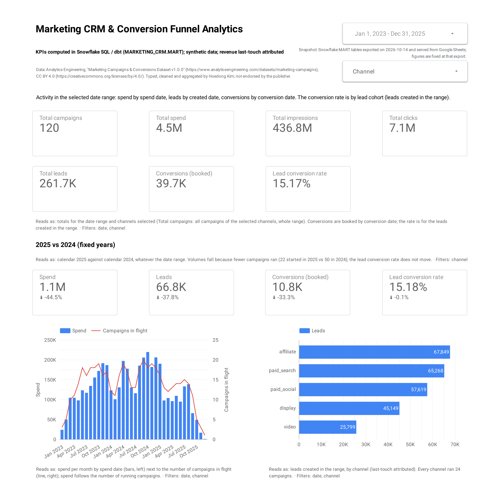
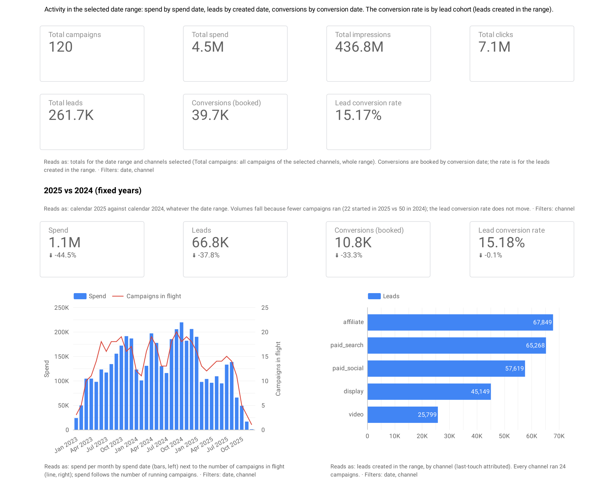
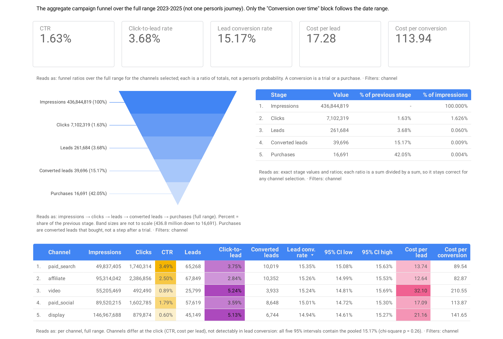
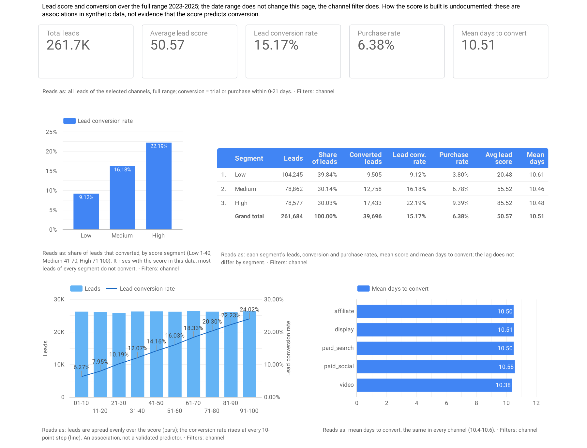
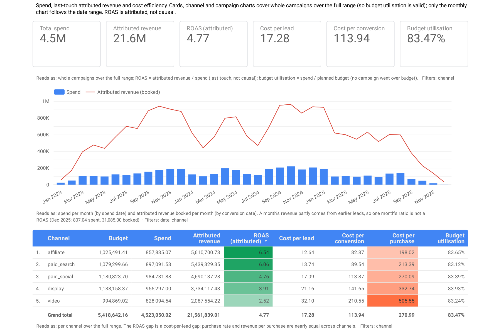

[](https://www.snowflake.com/)
[](https://www.getdbt.com/)
[](LICENSE)

# Marketing CRM & Conversion Funnel Analytics

**Where should the marketing budget go? This project follows ad spend through clicks and sign-ups
to paying customers, channel by channel, in one dashboard where every number is checked.**

*Solo project. Data: a synthetic marketing dataset of 120 campaigns and 261,684 leads, 2023 to 2025.*

[](https://datastudio.google.com/reporting/2a21fe4e-ef7f-4f08-94db-b8d6bb7cf920?hl=en)

*[Open the live dashboard →](https://datastudio.google.com/reporting/2a21fe4e-ef7f-4f08-94db-b8d6bb7cf920?hl=en) · [Read the full analysis →](docs/business_insights.md)*

---

## 🎯 Problem

A company advertises on five channels: affiliate sites, display banners, paid search, paid social
and video. Every campaign feeds the same **funnel**: ads are seen, some are clicked, some clicks
leave their details (a **lead**), and some leads go on to start a trial or buy (a **conversion**).
Spend goes in at the top; revenue comes out at the bottom. The data counts each step per campaign;
it does not follow individual people.

The question a marketing leader asks is simple: *which channels turn spend into paying customers
most cheaply, and where should the next budget go?*

Answering it reliably is harder than it looks. Spend is recorded per campaign per day, leads one by
one, and conversions up to three weeks after the lead. Match every day of a campaign's spend to
every one of its leads and the same spend is counted again and again: in this data, total spend
grows 2,495 times, from 4.5 million to 11.3 billion. Divide each month's conversions by that
month's new leads and the "conversion rate" swings between 8% and 94%, because a third of
conversions land in a later month than their lead.

This project builds one trustworthy source. Every figure is computed in SQL in a cloud data
warehouse and tested automatically, totals match the source files to the cent, and the key figures
are shown in a public dashboard.

## 📊 Data

The [Marketing Campaigns & Conversions Dataset v1.0.0](https://www.analyticsengineering.com/datasets/marketing-campaigns)
by Analytics Engineering (CC BY 4.0): a computer-generated record of a fictional company's
marketing, January 2023 to December 2025.

| Table | Rows | One row per |
|---|---:|---|
| Campaigns | 120 | campaign (24 in each channel), with its budget and goal |
| Daily spend | 11,240 | campaign per active day: ad views, clicks and spend |
| Leads | 261,684 | lead, with the campaign it is credited to and a lead score from 1 to 100 |
| Conversions | 39,696 | converted lead: 23,005 trials and 16,691 purchases |

The source names no currency, so amounts are shown without one.

**Read every result with three caveats:**

- **Synthetic.** The findings describe this dataset, not real markets or industry benchmarks.
- **Last-touch attribution.** Each lead, and the revenue it brings, is credited to a single campaign:
  the last one it came through. Revenue by channel shows credit, not cause.
- **No experiment.** Budgets were never varied at random, so nothing here proves what a budget change
  would do.

The publisher also ships short, deliberately messy extracts of the files. The project's cleaning
rules, run on them, catch all 15 planted errors ([cleaning notes](docs/data_cleaning.md)).

## 🔍 Approach

**Three terms first.**
- *Cost per lead* is spend divided by leads.
- *Conversion rate* is the share of leads that later start a trial or buy.
- *ROAS* (return on ad spend) is attributed revenue divided by spend. A ROAS of 4 means 4 of
  revenue credited for every 1 spent.

**1 — Load and reconcile.** The four source files are loaded unchanged into Snowflake, a cloud data
warehouse. Row counts, total spend (4,523,050.02) and total revenue (21,561,839.01) match the files
exactly.

**2 — Clean and model.** SQL turns the raw text into clean tables, with real dates and numbers. The
core rule: summarise each kind of record to the same level, such as one row per campaign per day,
*before* combining them, so nothing is counted twice.

**3 — Answer seven business questions in SQL.** They cover leads, conversion, cost per customer,
lead score, time to convert, ROAS and budget. Every number is printed next to a check against a
value computed independently; all checks pass.

**4 — Automate the build.** dbt, a standard tool for building and testing warehouse tables,
rebuilds every table from the raw data with one command. 265 automatic checks, 258 on the data and
7 on the calculation logic, all pass.

**5 — Build and check the dashboard.** Four pages in Google Data Studio. A separate SQL check works
out the number every chart should show (359 checks, none failed). Every chart on the dashboard was
read back against those numbers, then the public copy was checked against the original: all
matched. The public copy reads a fixed export of the final tables in Google Sheets, so it keeps
working without the warehouse.

## 📈 Results

**The whole programme, 2023 to 2025:** 4.52 million of spend → 436.8 million ad views →
7.1 million clicks → 261,684 leads → 39,696 conversions, of which 16,691 purchases →
21.56 million of attributed revenue.

**By channel.** What a lead and a paying customer cost, and what each channel returns:

| Channel | Leads | Cost per lead | Conversion rate | Cost per paying customer | ROAS |
|---|---:|---:|---:|---:|---:|
| Affiliate | 67,849 | 12.64 | 15.3% | 198 | **6.54** |
| Paid search | 65,268 | 13.74 | 15.4% | 213 | **6.06** |
| Paid social | 57,619 | 17.09 | 15.0% | 270 | 4.76 |
| Display | 45,149 | 21.16 | 14.9% | 333 | 3.91 |
| Video | 25,799 | 32.10 | 15.2% | 506 | 2.52 |
| **All channels** | **261,684** | **17.28** | **15.2%** | **271** | **4.77** |

*Cost per paying customer is spend divided by purchases; trials bring no revenue.*

**By lead score.** The share of leads in each score group, and how often they convert:

| Lead score | Share of leads | Conversion rate |
|---|---:|---:|
| Low (1–40) | 39.8% | 9.1% |
| Medium (41–70) | 30.1% | 16.2% |
| High (71–100) | 30.0% | 22.2% |

Leads convert within 0 to 21 days, 10 days at the median.

*Every number is printed and checked in [docs/evidence/](docs/evidence/). The written analysis,
[docs/business_insights.md](docs/business_insights.md), is a draft in final review.*

## 💡 Key Insights

**1 — The channels differ in what a lead costs, not in how well leads convert.** A video lead costs
2.5 times an affiliate lead (32.10 against 12.64), yet all five channels convert 14.9% to 15.4% of
their leads: a gap too small to tell apart from chance (a standard statistical test gives p = 0.26).
Revenue per purchase is nearly the same too, so the ROAS ranking is, in effect, a cost-per-lead
ranking.

**2 — Two channels are credited with more revenue than their share of spend.** Affiliate and paid
search take 39% of spend and are credited with 51% of the leads and 51% of the revenue. Video takes
18% of spend and is credited with 10% of the revenue.

**3 — In the two top channels, the biggest campaigns show lower returns.** In affiliate, the third
of campaigns that spent the most has a ROAS of 4.86, against 11.64 for the third that spent the
least (paid search: 5.03 against 8.08). This compares different campaigns, not one campaign given
more money, but it warns that the top channels' average ROAS may not hold as their budgets grow.

**4 — Higher lead scores go with higher conversion.** High-score leads convert 2.4 times as often
as low-score leads (22.2% against 9.1%), and every 10-point band converts more than the one below
it. How and when the score is made is undocumented, so this is a pattern in this data, not a proven
predictor.

**5 — 2025 was smaller mainly because fewer campaigns ran.** Spend fell 44.5% and leads 37.8%
against 2024, as 22 campaigns started in 2025 against 50 in 2024. The conversion rate shows no
detectable change. The data does not record why fewer campaigns ran.

## 🧭 What This Would Mean in Practice

- **For the budget:** the case for moving part of the video budget, then display, to paid search and
  affiliate is strong enough to **test, not yet to act on**. Last-touch credit may hide what video
  does earlier in a customer's path, and the biggest campaigns in the top channels show lower
  returns than the small ones. A test in randomly chosen regions, with the success rule agreed in
  advance, would settle it ([test designs](docs/business_insights.md#test-designs)).
- **For the sales team:** if the score is set before anyone follows up, calling high-score leads
  first is worth trying; here they convert at more than twice the rate of low-score leads. Even so,
  78% of them do not convert.
- **For reporting:** measure conversion rates by when the lead arrived, not when it converted,
  since a third of conversions land in a later month. And keep counting conversions after a
  campaign ends (up to 21 days in this data): 12% of conversions, with 2.53 million of revenue, come
  after the end date.
- **Where not to trust it:** several regularities here, such as a fixed price of ad views per
  channel, conversion delays spread evenly from 0 to 21 days and a cap of 35 leads per campaign per
  day, are settings of the data generator, not market facts.

## 📌 Takeaways

**Check the dashboard against the numbers, not by eye.** Copying the report to its public version
re-pointed many charts at the wrong fields, mostly without any error message. Every chart had to be
repaired against the original and every page checked again before the copy went public.

**A consistent pattern is still a hypothesis until it is tested.** Affiliate and paid search lead
on every descriptive view, yet the analysis ends with a test design, not a budget recommendation:
with last-touch credit and no experiment, the data cannot show what moving the money would do.

## 🖥 The Dashboard

<table>
  <tr>
    <td width="50%" valign="top"><a href="docs/images/overview.png"></a><br><b>Marketing Overview</b>: spend, leads and conversions over time, by channel and by campaign</td>
    <td width="50%" valign="top"><a href="docs/images/funnel.png"></a><br><b>Conversion Funnel</b>: how many make it from ad view to click, lead and conversion, by channel</td>
  </tr>
  <tr>
    <td width="50%" valign="top"><a href="docs/images/lead_quality.png"></a><br><b>Lead Quality & CRM</b>: conversion by lead score, and how long leads take to convert</td>
    <td width="50%" valign="top"><a href="docs/images/efficiency.png"></a><br><b>Marketing Efficiency & ROAS</b>: return on spend and cost per customer, by channel and by campaign</td>
  </tr>
</table>

**[Open the live dashboard](https://datastudio.google.com/reporting/2a21fe4e-ef7f-4f08-94db-b8d6bb7cf920?hl=en)**
(public, no sign-in). It shows a fixed copy of the data taken on 2026-10-14. Click a tile for the
full page.

**Run it yourself.** You need a Snowflake account (the free trial is enough) and Python 3.10 to
3.13. The full walkthrough is in [docs/setup_snowflake.md](docs/setup_snowflake.md); in short:

```bash
make setup                 # Python environment, Snowflake connector and dbt
make data                  # download and verify the dataset
make keys                  # key pairs for the two service users
make bootstrap-sql         # one-time admin script: paste into Snowflake and run
cp .env.example .env       # fill in the account name and the two key paths
make load                  # source files -> Snowflake, reconciled with the files
make load-challenge        # the messy extracts -> Snowflake (the dbt checks need them)
make dbt-deps dbt-build    # build and check every table
make analyses              # the seven business questions -> docs/evidence/
```

`make help` lists every target; [docs/dbt.md](docs/dbt.md) covers day-to-day dbt use.

## 📁 Repository Structure

```
├── sql/          Snowflake SQL: setup, data profiling, the analysis queries, dashboard check
├── dbt/          dbt project: cleaning rules, every table the dashboard reads, and their checks
├── scripts/      Tooling only (Python and shell): download, keys, load, connection checks, export
├── docs/         Analysis, metrics, data dictionary, data source, dashboard spec and checks, setup
│   ├── evidence/ Full output of every build, check and analysis run
│   └── images/   Dashboard screenshots
├── exports/      The fixed dashboard tables behind the public report
└── Makefile      The pipeline steps as make targets
```

Good places to start: [business_insights.md](docs/business_insights.md) (the analysis),
[kpi_definitions.md](docs/kpi_definitions.md) (every metric's formula) and
[architecture.md](docs/architecture.md) (data flow, security and design decisions).

## 🛠 Tech Stack


## License

[MIT](LICENSE). The dataset keeps its own license, [CC BY 4.0](https://creativecommons.org/licenses/by/4.0/)
([details](docs/data_source.md)).
