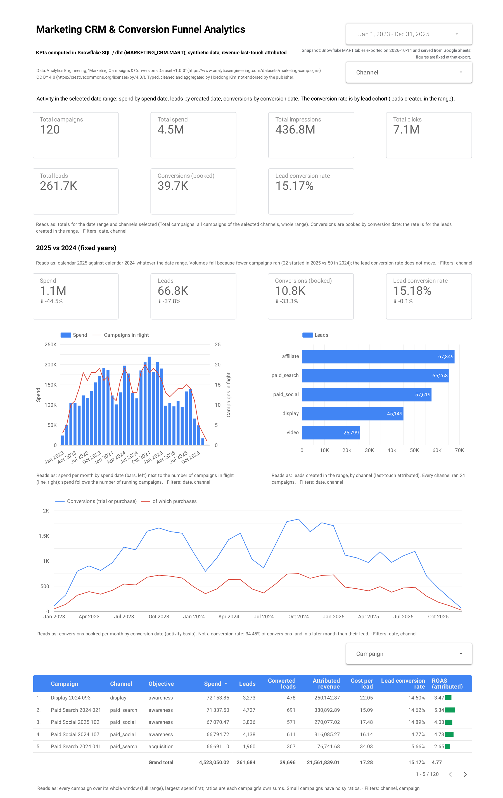
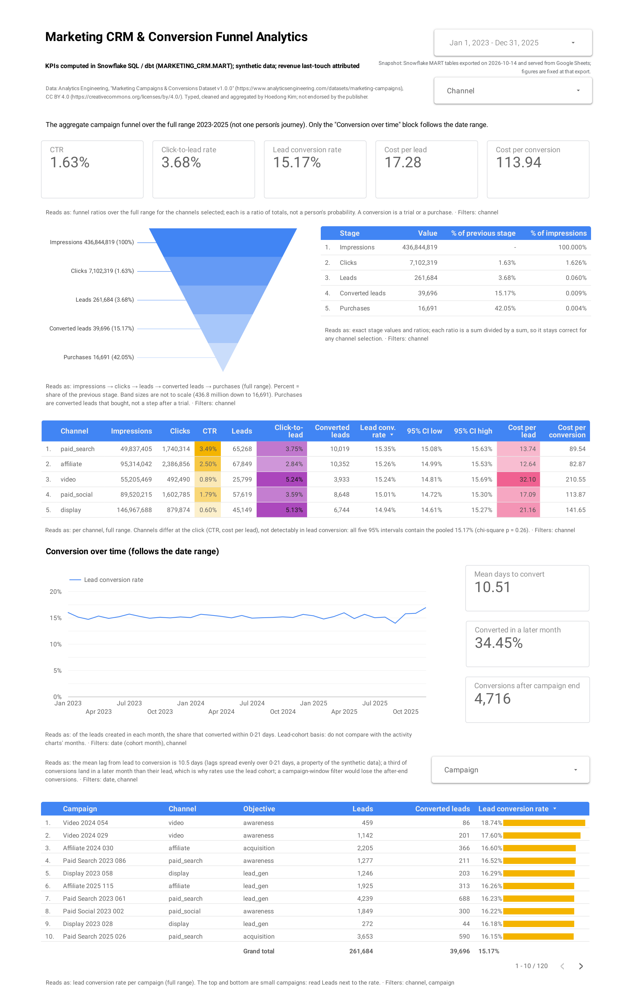
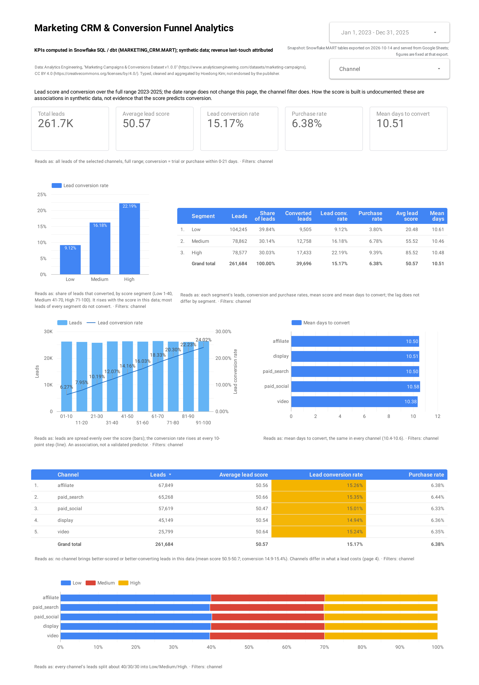
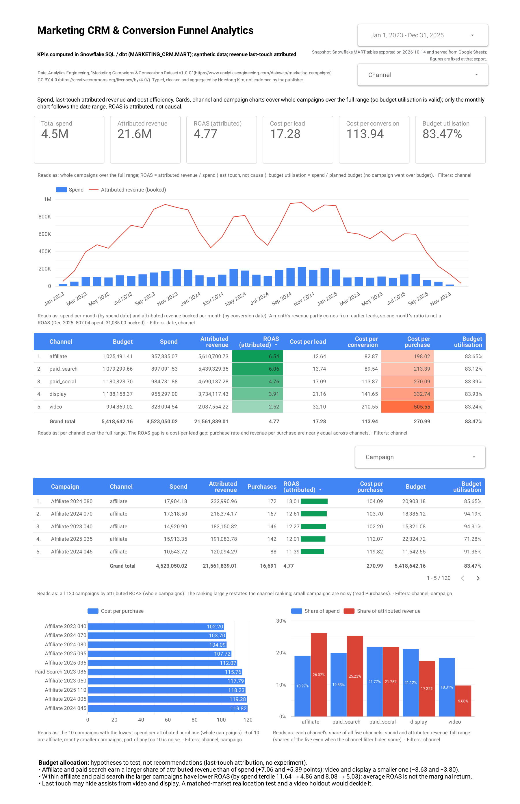

[](LICENSE)
[](data/README.md)

# Marketing CRM & Conversion Funnel Analytics

**Grain-correct marketing funnel KPIs, from spend through clicks and leads to trials and
purchases, computed in Snowflake SQL, managed with dbt Core and presented in a public Google Data Studio dashboard.**

*Solo project. Synthetic "Marketing Campaigns & Conversions" dataset (Analytics Engineering, CC BY 4.0).*

> **Status, 2026-10-18: Phases 1-6 of 7 done; Phase 7 (documentation) next.** The [dashboard](#-dashboard) is public, every value it shows was checked against the SQL, and it reads a frozen Google Sheets snapshot of the MART tables, so it keeps working after the Snowflake trial.
> - **What exists:** the Snowflake setup and loading tooling (admin bootstrap SQL, RAW DDL, a loader that reconciles control totals, connection checks), the Day-1 runbook, the Phase 2 profiling SQL with its full output and a written [data profile](docs/data_profile.md), the Phase 3 STAGING and core MART models with their tests, a [data dictionary](docs/data_dictionary.md) and [cleaning notes](docs/data_cleaning.md), the Phase 4 analysis marts and analysis SQL with their checks, [KPI definitions](docs/kpi_definitions.md) and a draft of the [business insights](docs/business_insights.md), and the Phase 5 dbt project that now builds and tests STAGING and MART, with its [guide](docs/dbt.md) and [lineage graph](docs/lineage.md), and the Phase 6 preparation: the dashboard build spec, its validation checklist and SQL, a funnel table for the funnel chart, and the frozen export of the dashboard tables for the Google Sheets snapshot.
> - **Snowflake account:** created 2026-10-13 (AWS US East 2 / Ohio, standard 30-day trial, ending about **2026-11-12**). The public dashboard already reads the Google Sheets snapshot, so the end of the trial does not affect it; `make export-check EXPORT_CHECK_ARGS=--offline` still verifies the exported files afterwards.
> - **Done in Snowflake (2026-10-13):** bootstrap run (and re-run, idempotent); `make sf-check` / `make sf-check-bi` pass; `make load` landed all four source tables in `RAW` with every control total equal to the local files (rows, distinct keys, character counts, spend 4,523,050.02, revenue 21,561,839.01); `make load-challenge` landed the dirty extracts byte-for-byte; `MART.CONNECTION_TEST` built for the Data Studio test.
> - **Data Studio connection test passed (2026-10-13):** the Snowflake partner connector signs in as `SVC_CRM_BI` with the key-pair (base64 key body only; the full PEM is rejected) and reads `MART.CONNECTION_TEST` ([results](docs/phase1_connection_test.md#results-fill-in-do-not-invent)).
> - **Phase 2 done (2026-10-13):** `make profile` and `make profile-challenge` profiled all eight RAW tables with read-only Snowflake SQL, and every check row (242 + 182) reproduced the local profiling exactly. The clean release passes every check; the 15 defects of the cleaning-challenge extracts are located ([data profile](docs/data_profile.md)).
> - **Phase 3 done (2026-10-14):** `make models` built 8 STAGING views (the clean `STG_*` views and the `STG_CHALLENGE_*` cleaning-challenge track) and 5 core MART tables (`DIM_DATE`, `DIM_CAMPAIGN`, `FCT_DAILY_SPEND`, `FCT_LEAD_CONVERSIONS`, `MART_CAMPAIGN_PERFORMANCE`). Their tests pass: 194 + 245 check rows, 0 FAIL ([evidence](docs/evidence/)). The clean views keep every RAW row and reproduce the Phase 2 control totals to the cent; total spend is 4,523,050.02 in every MART table that carries spend, and every campaign's bases equal the Phase 2 baseline. On the dirty extracts the same rules flag all 15 defects, and 6,118 of 6,120 rows reproduce the clean release; the 2 blank dates that no evidence can recover stay NULL ([cleaning notes](docs/data_cleaning.md)).
> - **Phase 4 done (2026-10-14):** `make analysis-marts analyses` built 5 analysis marts (`FCT_CAMPAIGN_DAILY_ACTIVITY`, `MART_MONTHLY_MARKETING`, `MART_MONTHLY_COHORT`, `MART_CHANNEL_PERFORMANCE`, `MART_LEAD_QUALITY`) and ran the four read-only analysis files, one per dashboard page. Each analysis prints its numbers next to checks against independently computed values: 258 mart test rows and 126 / 232 / 150 / 80 analysis check rows PASS, 0 FAIL ([evidence](docs/evidence/)). Every KPI of the four planned dashboard pages is defined and computed in SQL ([KPI definitions](docs/kpi_definitions.md), with a coverage matrix), and the seven business questions have draft answers ([business insights](docs/business_insights.md)).
> - **Phase 5 done (2026-10-14):** the dbt Core 1.12 project in [`dbt/`](dbt/) now builds every STAGING view and MART table under the same names, replacing the SQL-built objects in place, so the analyses keep working unchanged and the Phase 6 dashboard is built on the same tables. `make dbt-build`: 3 seeds of independent expected values, 8 staging views, the ephemeral `int_lead_conversions`, 10 MART tables, 245 data tests (unique, not_null, relationships, accepted_values, dbt_utils, and 15 singular tests, 11 of them against the independent seeds) and 7 unit tests: PASS=273, ERROR=0, 0 deprecations, source freshness 8 of 8 PASS ([evidence](docs/evidence/05_dbt_build.txt)). Parity with the hand-written build: all 18 objects have identical rows, columns and types, and the 7 Phase 3-4 check files pass unchanged on the dbt build (1,288 PASS rows, 0 FAIL; every printed analysis number identical) ([evidence](docs/evidence/05_dbt_parity.txt)). `FCT_LEAD_CONVERSIONS` now takes its campaign attributes from `STG_CAMPAIGNS` through `int_lead_conversions` instead of from `DIM_CAMPAIGN` (identical values, tested). One dbt target writes the live schemas: see [architecture.md](docs/architecture.md), decision 10. How the project is built, tested and proven equal: [docs/dbt.md](docs/dbt.md); the DAG as Mermaid diagrams: [docs/lineage.md](docs/lineage.md).
> - **Phase 6 done (2026-10-18):** the four-page Data Studio dashboard is [public](#-dashboard). It was built by hand from the repository's instructions (the report needs a Google sign-in), and every number it shows was computed and checked in SQL first.
>   - **Build spec:** [docs/dashboard_spec.md](docs/dashboard_spec.md) gives every component of the four pages with its data source, fields, settings and filters, and the values it must show.
>   - **Validation:** [docs/dashboard_validation.md](docs/dashboard_validation.md) is the sign-off checklist. Its expected values come from `sql/07_dashboard_validation.sql`, which computes each component the way the report does (same MART table, aggregation and `SUM(x) / SUM(y)` field) and checks it against independent references: 27 statements, 359 PASS rows, 0 FAIL ([evidence](docs/evidence/07_dashboard_validation.txt)). Both passes are signed off: pass 1 on the live Snowflake report (plus three PDF reviews) and pass 2 on the public Google Sheets copy; every value read matched.
>   - **Funnel table:** one new dbt table for the funnel chart, `MART_CONVERSION_FUNNEL` (25 rows, channel × stage). `make dbt-test` passed 258 data tests and 7 unit tests ([evidence](docs/evidence/06_funnel_mart.txt)).
>   - **Snapshot:** `make export-marts` wrote 8 MART tables (14,440 rows: the 7 the report reads, plus `DIM_CAMPAIGN`) to [exports/](exports/README.md) as CSVs, an .xlsx workbook for Google Sheets and a manifest; `make export-check` found the files and the live tables equal to the manifest ([evidence](docs/evidence/06_export_check.txt)). The public report reads seven Google Sheets data sources built from that workbook (export of 2026-10-14), as in the runbook [docs/sheets_snapshot.md](docs/sheets_snapshot.md).
>   - **Screenshots:** the four pages in [dashboards/](dashboards/).
> - **What has not happened yet:** the final write-up (Phase 7). The insights are a draft: findings about a synthetic dataset, with last-touch attribution and no experiment behind them.

---

## 🖥 Dashboard

**[Open the live dashboard](https://datastudio.google.com/reporting/2a21fe4e-ef7f-4f08-94db-b8d6bb7cf920)**
(public, no sign-in). Number and date formats follow the viewer's Google language; add `?hl=en` to
the link for the English formats shown below. The figures come from a frozen export of the
Snowflake MART tables (2026-10-14), served from Google Sheets.

| Marketing Overview | Conversion Funnel |
|---|---|
| [](dashboards/overview.png) | [](dashboards/funnel.png) |
| **Lead Quality & CRM** | **Marketing Efficiency & ROAS** |
| [](dashboards/lead_quality.png) | [](dashboards/efficiency.png) |

## 🎯 Business Objective

A marketing team runs paid campaigns across five channels: affiliate, display, paid search,
paid social and video. Each campaign has a budget, a daily delivery record (impressions, clicks,
spend), the leads it generated and the leads that converted to a trial or a purchase.

**Objective:** *How can a company optimize marketing spending, improve lead conversion rates, and
maximize campaign performance through SQL-driven CRM analytics?* In practice: where should the
marketing budget go to acquire and convert customers most efficiently?

The goal is one trustworthy place that shows this. Every KPI is computed from versioned
Snowflake SQL and reconciled to the source data to the cent.

## ❓ Business Questions

The questions this project is built to answer. Phase 4 answers them in SQL; the draft write-up,
with every number cited to its evidence file, is [docs/business_insights.md](docs/business_insights.md).

1. Which marketing channels generate the most leads?
2. Which channels have the highest lead-to-conversion rate?
3. Which campaigns acquire customers most cost-efficiently?
4. How does the conversion rate change with lead score?
5. How long does it take a lead to convert?
6. Which channels and campaigns have the highest ROAS?
7. Which channels should the marketing budget be allocated to first?

How they are measured:

- **Funnel.** Impressions → clicks → leads → conversions is an *aggregate* campaign funnel, not one person's journey: the data cannot follow an individual from trial to purchase.
- **Lead score.** Scores are segmented (Low 1-40, Medium 41-70, High 71-100). How the score is produced is undocumented, so it is not assumed to predict conversion.
- **ROAS.** It rests on the dataset's last-touch attribution, so it describes attributed revenue, not causal impact.
- **Time.** Activity-based monthly figures and lead-cohort figures answer different questions and are never mixed.

## 📈 Headline results (draft)

Draft findings from the Phase 4 SQL, about this synthetic dataset only. Revenue is last-touch
attributed and nothing was randomised, so nothing here is causal. Every number is printed and
checked in [docs/evidence/](docs/evidence/); methods and caveats are in
[docs/business_insights.md](docs/business_insights.md).

- **Leads (Q1).** Affiliate has the most attributed leads, 67,849 of 261,684 (25.93%), and video the fewest, 25,799 (9.86%). Per 1,000 of spend affiliate gets 79.0933 leads and video 31.1547, in the same channel order in every year.
- **Conversion (Q2).** Channel lead-to-conversion rates run from 0.149372 (display) to 0.153506 (paid_search), and a chi-square test does not tell them apart (p = 0.264383). In this data the channels differ in what a lead costs, not detectably in how often it converts.
- **Cost of a customer (Q3).** Spend per last-touch attributed purchase (a paying customer) is 198.0229 in affiliate and 505.5522 in video at channel level; the cheapest campaign is CMP0040 (affiliate) at 102.1979 per purchase. The campaign ranking largely restates the channel ranking, and the extremes rest on few purchases.
- **Lead score (Q4).** 9.12% of Low-score leads converted, 16.18% of Medium and 22.19% of High: an association in this data, not a validated predictor (how the score is made is undocumented).
- **Time to convert (Q5).** 0 to 21 days, median 10. 34.45% of conversions land in a later calendar month than their lead, so monthly conversion rates are computed by lead cohort.
- **ROAS (Q6).** Attributed ROAS runs from 6.540536 (affiliate) and 6.063294 (paid_search) down to 2.520913 (video). Across channels cost per lead varies 2.539-fold, purchase rate and revenue per purchase only 1.018-fold and 1.021-fold.
- **Budget (Q7).** Moving budget from video and display to affiliate and paid_search is a hypothesis to test, not a finding: the larger affiliate and paid_search campaigns have a lower ROAS than their smaller ones (a comparison across campaigns, not a measured response to more spend), and last-touch attribution may hide assists from video and display. The draft describes the experiments that would decide it.
- **2025.** Volumes fall mainly because fewer campaigns ran (22 started against 50 in 2024); the monthly cohort conversion rate shows no detectable change over the three years.

## 📊 Data

[Marketing Campaigns & Conversions Dataset v1.0.0](https://www.analyticsengineering.com/datasets/marketing-campaigns)
by Analytics Engineering, CC BY 4.0. Details, checksums and caveats: [data/README.md](data/README.md).

| Table | Rows | Grain |
|---|---:|---|
| campaigns | 120 | one row per campaign (5 channels × 24) |
| daily_spend | 11,240 | one row per campaign per active date |
| leads | 261,684 | one row per lead |
| conversions | 39,696 | one row per converted lead (trial or purchase) |

The publisher also ships **dirty cleaning-challenge extracts**: duplicates, blank required values,
casing/whitespace problems and slash dates. `make load-challenge` loads them into separate
`RAW.CHALLENGE_*` tables for the Phase 3 cleaning track; they are never mixed with the clean release.

**Read every result with these caveats:**

- **Synthetic.** The data models a fictional business: no real companies, people or industry benchmarks.
- **Last-touch attribution.** ROAS and revenue by channel describe *attributed* revenue, **not causal impact**.
- **Excluded conversions.** Offline and view-through conversions are not included.
- **Coverage.** The documented coverage is 2023-01-01 to 2025-12-31; observed activity runs 2023-01-04 to 2025-12-02, with conversions to 2025-12-21.

## 🛠 Tech Stack

| Layer | Tool | Role here |
|---|---|---|
| Warehouse | **Snowflake** (trial account) | Storage and compute: database `MARKETING_CRM`, schemas `RAW` → `STAGING` → `MART`, warehouse `MARKETING_WH` (X-Small, Gen1, auto-suspend 60 s) |
| Transformation & KPI logic | **Snowflake SQL** | All cleaning, modelling and KPI logic |
| Model management & tests | **dbt Core 1.12** + dbt-snowflake 1.12, dbt_utils | Phase 5: builds every STAGING view and MART table under the Phase 3-4 names; Phase 6 added `MART_CONVERSION_FUNNEL`. 258 data tests, 7 unit tests, seeds of independent expected values, source freshness, lineage ([docs/dbt.md](docs/dbt.md)) |
| BI | **Google Data Studio** (formerly Looker Studio) | Phase 6: public four-page [dashboard](#-dashboard): Marketing Overview, Conversion Funnel, Lead Quality & CRM, Marketing Efficiency & ROAS, built by hand from [docs/dashboard_spec.md](docs/dashboard_spec.md); it reads a frozen Google Sheets snapshot of the MART tables ([exports/](exports/README.md)), so it outlives the Snowflake trial |
| Docs & versioning | **Git / GitHub** | Code, SQL, runbooks, decision log |
| Tooling only | Python 3.10-3.13 | Download and verify data, upload to Snowflake (PUT/COPY), connection checks, export of the finished MART tables (`exports/`). No analysis happens in Python. |

No machine learning and no web app: this is a SQL / analytics-engineering project.

## 🏗 Architecture

```
 CSV release (4 files)  +  cleaning-challenge extracts (4 dirty files)
          │  make data: pinned SHA-256, safe unzip
          ▼  make load / load-challenge: PUT + COPY, exact control-total reconciliation
 RAW        all-VARCHAR, lossless, + lineage columns  (+ RAW.CHALLENGE_*)     CRM_LOADER
          │  Phase 3 SQL, then dbt Core (Phase 5): types, cleaning, tests
          ▼
 STAGING    STG_* views 1:1 with RAW  (+ STG_CHALLENGE_* cleaning track)       CRM_TRANSFORMER
          │  aggregate each fact to a common grain FIRST, then join
          ▼
 MART       DIM_DATE, DIM_CAMPAIGN, FCT_DAILY_SPEND, FCT_LEAD_CONVERSIONS,     CRM_TRANSFORMER
            MART_CAMPAIGN_PERFORMANCE (Phase 3);
            FCT_CAMPAIGN_DAILY_ACTIVITY, MART_MONTHLY_MARKETING, MART_MONTHLY_COHORT,
            MART_CHANNEL_PERFORMANCE, MART_LEAD_QUALITY (Phase 4 analysis marts);
            MART_CONVERSION_FUNNEL (Phase 6, the funnel chart)
          │  Snowflake connector, key-pair service user                        CRM_REPORTER
          ▼
 Google Data Studio: live during the build, then a frozen Google Sheets snapshot
                     (make export-marts -> exports/; docs/sheets_snapshot.md)
```

| Rule | Why it matters |
|---|---|
| Aggregate first, then join | A naive `daily_spend ⋈ leads` join inflates spend **2,495×** (4.52 M → 11.3 B). |
| Keep activity-based and lead-cohort time series separate | 34.45% of conversions (13,675 of 39,696) land in a later month than their lead. A naive monthly "conversion rate" swings from 8.3% to 93.8%; the lead-cohort rate stays between 13.9% and 16.9% ([evidence](docs/evidence/04_funnel.txt), statements [16]-[17]). |
| Ratios are ratios of sums | Never average row-level CTR / CPL / ROAS. |
| RAW is a byte-faithful copy | Typing and cleaning happen in STAGING, where they are versioned and tested. |

Security model, cost guardrails and the full decision log: [docs/architecture.md](docs/architecture.md).
The dbt project, its tests and the parity proof: [docs/dbt.md](docs/dbt.md); the model lineage as
Mermaid diagrams: [docs/lineage.md](docs/lineage.md).

## 🗺 Roadmap

| Phase | Scope | Status |
|---|---|---|
| 1. Snowflake setup | Warehouse, database, schemas, roles, key-pair service users, resource monitors; RAW load with reconciliation; early Data Studio connection test | **Done** (2026-10-13). RAW reconciled exactly to the source files; Data Studio reads MART via key-pair |
| 2. Ingestion & EDA | Profile RAW in Snowflake SQL; confirm the local profiling | **Done** (2026-10-13). Every check reproduced the local profiling exactly: [docs/data_profile.md](docs/data_profile.md) |
| 3. Cleaning & modelling | Typed, tested STAGING; cleaning-challenge track; grain-safe MART facts and dimensions | **Done** (2026-10-14). 8 STAGING views and 5 core MART tables; 194 + 245 test rows PASS, 0 FAIL; challenge track reproduces 6,118 of 6,120 clean rows: [docs/data_cleaning.md](docs/data_cleaning.md), [docs/data_dictionary.md](docs/data_dictionary.md) |
| 4. Advanced SQL | Analysis marts (channel, lead quality, monthly, daily activity spine); 10 analyses answering the business questions (window functions, cohorts, funnel, budget utilisation) | **Done** (2026-10-14). 5 analysis marts (258 test rows PASS) and 4 analysis files (126 + 232 + 150 + 80 check rows PASS), 0 FAIL: [docs/kpi_definitions.md](docs/kpi_definitions.md), [docs/business_insights.md](docs/business_insights.md) (draft), [evidence](docs/evidence/) |
| 5. dbt | STAGING/MART as dbt Core models with tests, sources, freshness, docs | **Done** (2026-10-14). 8 staging views, 1 ephemeral intermediate model, 10 MART tables under the same names; 245 data tests + 7 unit tests PASS; 18 of 18 objects identical to the SQL build: [docs/dbt.md](docs/dbt.md), [docs/lineage.md](docs/lineage.md), [dbt/](dbt/), [evidence](docs/evidence/05_dbt_build.txt), [parity](docs/evidence/05_dbt_parity.txt) |
| 6. Dashboard | Data Studio: Marketing Overview, Conversion Funnel, Lead Quality & CRM, Marketing Efficiency & ROAS; Google Sheets snapshot before the trial ends (about 2026-11-12) | **Done** (2026-10-18). [Public dashboard](#-dashboard) on the Google Sheets snapshot; [build spec](docs/dashboard_spec.md); [validation](docs/dashboard_validation.md) signed off on Snowflake and on Sheets, every value matching `sql/07` (359 PASS, 0 FAIL, [evidence](docs/evidence/07_dashboard_validation.txt)); `MART_CONVERSION_FUNNEL` ([evidence](docs/evidence/06_funnel_mart.txt)); snapshot export in [exports/](exports/README.md) (`make export-check` PASS, [evidence](docs/evidence/06_export_check.txt)) and its [runbook](docs/sheets_snapshot.md); [screenshots](dashboards/) |
| 7. Documentation | Finalise `docs/business_insights.md` (Phase 4 draft) once the dashboard exists; final pass over `docs/kpi_definitions.md` and `docs/data_dictionary.md` (both cover the Phase 4 marts); this README summarises them, with limitations and future work | Planned |

## 🚀 Quickstart

You need a Snowflake account where you can run one script as ACCOUNTADMIN. Follow the full
Day-1 runbook in [docs/setup_snowflake.md](docs/setup_snowflake.md). In short:

```bash
make setup                 # .venv (Python 3.10-3.13): connector 4.8, dbt-core 1.12.5, dbt-snowflake 1.12.2, openpyxl 3.1.5
make data                  # download + verify the dataset (pinned SHA-256, safe unzip)
make keys                  # RSA key pairs for the two service users, in ~/.snowflake/keys
make bootstrap-sql         # -> build/snowflake_bootstrap.sql; paste into Snowsight and Run All (as admin)
cp .env.example .env       # fill in SNOWFLAKE_ACCOUNT and the two key paths
make sf-check              # connection, roles, warehouse settings, schemas, grants
make load                  # clean release -> RAW, reconciled against local control totals
make load-challenge        # dirty extracts -> RAW.CHALLENGE_*
make connection-test-table # MART.CONNECTION_TEST for the Data Studio test
make sf-check-bi           # BI user: can read MART, cannot read RAW
make profile               # Phase 2: profile the clean RAW tables -> docs/evidence/01_data_profiling.txt
make profile-challenge     # Phase 2: profile the dirty extracts -> docs/evidence/01b_challenge_profiling.txt
make dbt-deps              # Phase 5: install dbt_utils as pinned in dbt/package-lock.yml
make dbt-debug             # Phase 5: dbt debug: profile from the root .env, Snowflake connection
make dbt-build             # Phase 5: seeds check, parse, dbt build (seeds, STAGING, MART, all tests), freshness, docs -> docs/evidence/05_dbt_build.txt
make analyses              # Phase 4: run the 4 analysis files -> docs/evidence/03_overview.txt ... 06_efficiency.txt
make dbt-parity            # Phase 5, read-only: parity snapshot (+ diff), hand-written SQL rebuilt from RAW vs the deployed objects, the 7 SQL check files
```

Day to day, after the first build (details and the full target list: [docs/dbt.md](docs/dbt.md#how-to-run)):

```bash
make dbt-build-select DBT_SELECT=stg_leads+   # rebuild + test one model and everything downstream of it
make dbt-test                                 # the 258 data tests and 7 unit tests on the deployed objects, no rebuild
make dbt-docs                                 # dbt docs site, also as one file: dbt/target/static_index.html (git-ignored)
make dbt-lineage                              # dbt parse, then regenerate docs/lineage.md (Mermaid)
make expected-seeds-check                     # offline: the independent seeds still match the CSV files
```

dbt always runs from the repository root (`.venv/bin/dbt ... --project-dir dbt --profiles-dir dbt`),
so it reads the root `.env`. Never `pip install dbt`: that installs the separate dbt v2 engine.
The hand-written Phase 3-4 build is kept as `make staging` / `marts` / `analysis-marts` / `models`
(legacy): each one **replaces the dbt-built objects** of the same names, so use them only to
reproduce the Phase 3-4 evidence, and run `make dbt-build` afterwards.

Phase 6, the dashboard. The report itself was built by hand in Data Studio from
[docs/dashboard_spec.md](docs/dashboard_spec.md) and signed off with
[docs/dashboard_validation.md](docs/dashboard_validation.md). The repository side:

```bash
make export-marts                              # the dashboard's MART tables, read as the BI user -> exports/ (CSVs, .xlsx for Google Sheets, manifest.json)
make export-check                              # exports/ vs manifest.json and vs the live tables; exit 1 on any difference
make export-check EXPORT_CHECK_ARGS=--offline  # the files only, no Snowflake (works after the trial)
.venv/bin/python scripts/run_sql.py --role CRM_TRANSFORMER --max-rows 300 sql/07_dashboard_validation.sql
                                               # read-only: the value every dashboard component must show, each checked;
                                               # prints to the terminal (last run: docs/evidence/07_dashboard_validation.txt)
```

The move to the Google Sheets snapshot (done 2026-10-18; the public report reads it): [docs/sheets_snapshot.md](docs/sheets_snapshot.md).

`make help` lists every target. `make load-dry-run` runs all local checks and prints the SQL
without contacting Snowflake. The profile, staging, marts, analysis-marts, analyses, dbt-build,
export-marts and export-check targets write each run to `build/` first and replace the evidence
files in `docs/evidence/` only when every step of the target exits 0 (no `FAIL` row, no dbt
error; `export-check` only when it also queried Snowflake).

## 📁 Repository Structure

```
├── Makefile                      make help lists every target
├── requirements.txt              snowflake-connector-python 4.8, python-dotenv, dbt-core 1.12.5, dbt-snowflake 1.12.2, openpyxl 3.1.5
├── .env.example                  connection settings template (.env itself is git-ignored)
├── data/
│   ├── README.md                 source, license, checksums, caveats, coverage
│   └── raw/                      dataset zips + extracted CSVs (downloaded by make data, git-ignored)
├── docs/
│   ├── setup_snowflake.md        Day-1 runbook: sign-up, bootstrap, load, troubleshooting, costs
│   ├── phase1_connection_test.md Data Studio connection test checklist + results table
│   ├── architecture.md           data flow, security model, design decisions
│   ├── data_profile.md           Phase 2 data profile: quality, grain, distributions, time, challenge defects
│   ├── data_cleaning.md          Phase 3 cleaning rules and reasons, challenge-track results, test guarantees
│   ├── data_dictionary.md        RAW / STAGING / MART core + analysis marts + the Phase 6 funnel mart: grain, rows, keys, every column and type
│   ├── kpi_definitions.md        every KPI: formula, basis, grain, MART source, Data Studio field; coverage matrix
│   ├── business_insights.md      (draft, Phase 4; final in Phase 7) answers to the 7 business questions, budget hypotheses and tests
│   ├── dbt.md                    Phase 5: why dbt Core v1, layers, schema override, tests, seeds, parity proof, how to run
│   ├── lineage.md                Phase 5: the dbt DAG as Mermaid diagrams + tables (generated by scripts/dbt_lineage.py)
│   ├── dashboard_spec.md         Phase 6: build spec of the four Data Studio pages: data sources, fields, settings, filters, expected values
│   ├── dashboard_validation.md   Phase 6: sign-off checklist (expected / observed / match) for every component, from sql/07
│   ├── sheets_snapshot.md        Phase 6: runbook for moving the report to the frozen Google Sheets snapshot before the trial ends
│   └── evidence/                 full output of make profile / profile-challenge / staging / marts / analysis-marts / analyses / dbt-build,
│                                 the Phase 5 parity report, and Phase 6: the funnel mart, export-marts, export-check, sql/07
├── scripts/
│   ├── download_data.sh          download, verify, safely extract the dataset
│   ├── generate_keys.sh          RSA 2048 PKCS#8 key pairs + fingerprints
│   ├── render_bootstrap.py       fills the public keys into the admin bootstrap SQL
│   ├── sfconn.py                 shared key-pair connection helper and SQL-file runner
│   ├── check_connection.py       make sf-check / sf-check-bi
│   ├── load_raw.py               local checks, PUT/COPY, exact local vs Snowflake reconciliation
│   ├── run_sql.py                run a .sql file with a given role
│   ├── independent_check.py      Phase 5: the dbt seeds of independent expected values, from the CSVs (csv + decimal)
│   ├── parity_diff.py            Phase 5: compare two parity snapshots field by field
│   ├── parity_minus.py           Phase 5: read-only parity SQL: hand-written bodies rebuilt from RAW vs the deployed objects
│   ├── dbt_lineage.py            Phase 5: docs/lineage.md from dbt/target/manifest.json (make dbt-lineage)
│   └── export_marts.py           Phase 6: export the dashboard's MART tables as the BI user, and check them (make export-marts / export-check)
├── sql/
│   ├── 01_data_profiling.sql     Phase 2: read-only profiling of the clean RAW tables
│   ├── 01b_challenge_profiling.sql  Phase 2: read-only profiling of the RAW.CHALLENGE_* extracts
│   ├── 02_data_cleaning.sql      Phase 3: the 8 STAGING views (clean track + challenge track)
│   ├── 02_data_cleaning_tests.sql   Phase 3: read-only STAGING tests + challenge reconciliation
│   ├── 02b_core_models.sql       Phase 3: the 5 core MART tables (dimensions, facts, campaign KPIs)
│   ├── 02b_core_models_tests.sql    Phase 3: read-only MART tests (grain, totals, Phase 2 baseline)
│   ├── 02c_analysis_marts.sql    Phase 4: the 5 analysis marts (daily activity spine, monthly, cohort, channel, lead quality)
│   ├── 02c_analysis_marts_tests.sql Phase 4: read-only tests of the analysis marts (totals, independent paths)
│   ├── 03_marketing_overview.sql Phase 4: dashboard page 1; analyses #1, #2, #10 (read-only, self-checking)
│   ├── 04_conversion_funnel.sql  Phase 4: page 2; analyses #3-#5 (funnel, conversion rate, cost per lead)
│   ├── 05_lead_analysis.sql      Phase 4: page 3; analyses #6-#7 (lead score, time to convert)
│   ├── 06_marketing_efficiency.sql  Phase 4: page 4; analyses #8-#9 (campaign ranking, ROAS, budget)
│   ├── 07_dashboard_validation.sql  Phase 6: read-only: the value every dashboard component must show, checked against independent references
│   ├── parity/parity_snapshot.sql  Phase 5: read-only fingerprint of every STAGING and MART object
│   └── setup/
│       ├── 00_bootstrap.template.sql  one-time admin setup (warehouse, DB, roles, users, monitors)
│       ├── 01_raw_objects.sql         lossless file format, stage, 8 RAW tables
│       ├── 02_raw_load_checks.sql     load reconciliation as plain SQL for Snowsight
│       └── 03_connection_test.sql     MART.CONNECTION_TEST (Phase 1 only)
├── dbt/                          Phase 5: dbt Core 1.12 project (run from the repo root with --project-dir dbt --profiles-dir dbt)
│   ├── dbt_project.yml, profiles.yml, packages.yml, package-lock.yml   config (connection settings: env_var only), dbt_utils pinned
│   ├── macros/                   generate_schema_name (exact STAGING / MART) + staging/clean_*.sql (the cleaning rules)
│   ├── models/staging/           8 views + sources (RAW, freshness) + unit tests; cleaning rules in macros/staging/
│   ├── models/intermediate/      int_lead_conversions (ephemeral)
│   ├── models/marts/             11 MART tables (MART_CONVERSION_FUNNEL since Phase 6) + unit tests
│   ├── models/exposures.yml      downstream consumers (Data Studio dashboard, Phase 4 analyses); overview.md: dbt docs front page
│   ├── seeds/                    independent expected values (scripts/independent_check.py) + the publisher's reference
│   └── tests/                    16 singular tests (12 compare with the seeds)
├── exports/                      Phase 6: the frozen dashboard tables (make export-marts): 8 CSVs,
│                                 marketing_crm_dashboard_snapshot.xlsx (for Google Sheets), manifest.json, README.md
└── dashboards/                   Phase 6: screenshots of the four public dashboard pages: overview.png, funnel.png,
                                  lead_quality.png, efficiency.png
```

## License

- **Code and documentation:** [MIT](LICENSE), © 2026 Hoedong Kim.
- **Data:** the source files are not included in the repository (`make data` downloads them).
  [`exports/`](exports/README.md) holds the aggregated MART tables the dashboard is built on,
  derived from them. Neither is covered by the MIT license. The data is
  "Marketing Campaigns & Conversions Dataset v1.0.0" by
  [Analytics Engineering](https://www.analyticsengineering.com/datasets/marketing-campaigns),
  licensed under [CC BY 4.0](https://creativecommons.org/licenses/by/4.0/).
  **Changes:** RAW holds byte-identical copies; STAGING, MART, the dashboard and its Sheets
  snapshot are typed, cleaned and aggregated by Hoedong Kim, and are not endorsed by the
  publisher. Every public report and Sheet carries this attribution (see
  [docs/architecture.md](docs/architecture.md), decision 8).
