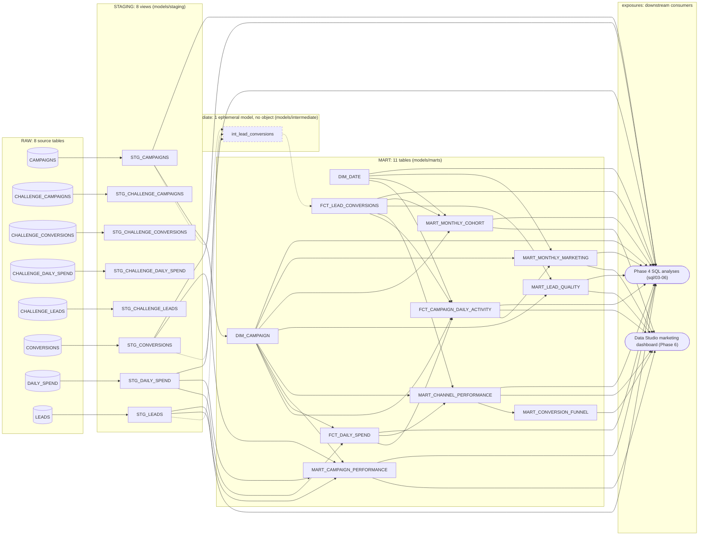
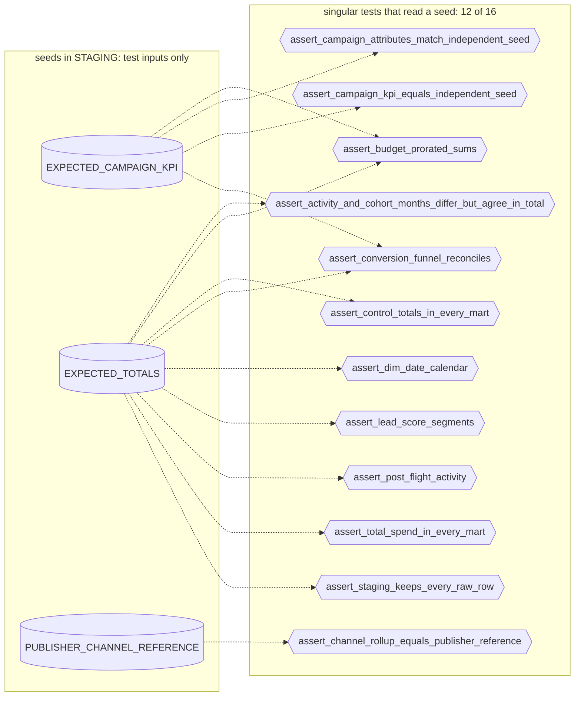

# dbt lineage

<!-- Generated by scripts/dbt_lineage.py from dbt/target/manifest.json. Do not edit by hand:
     run `make dbt-lineage` (dbt parse + this script); `--check` tells whether it is current. -->

The DAG of the dbt project `marketing_crm` (dbt Core 1.12.5), generated from
`dbt/target/manifest.json` by [`scripts/dbt_lineage.py`](../scripts/dbt_lineage.py)
(`make dbt-lineage`). How the project is built and tested: [dbt.md](dbt.md). The interactive
version of the same graph is the dbt docs site: `make dbt-docs` writes
`dbt/target/static_index.html` (one file, opens from disk; not committed).

## Model lineage

RAW sources on the left, then the STAGING views, the ephemeral intermediate model (dashed
border and dashed edges: dbt compiles it into its child as a CTE, so it creates no object),
the MART tables and, on the right, the exposures that read them. An exposure that reads
every model of a layer has one edge from that layer. Node labels are the Snowflake object
names (dbt model names are the same in lower case).

## Inventory

| Resource | Count |
|---|---:|
| Sources (RAW tables) | 8 |
| Models | 20 (1 ephemeral, 11 tables, 8 views) |
| Seeds | 3 |
| Data tests | 258 (severity error 257, warn 1) |
| &nbsp;&nbsp;`not_null` | 103 |
| &nbsp;&nbsp;`dbt_utils.accepted_range` | 37 |
| &nbsp;&nbsp;`accepted_values` | 32 |
| &nbsp;&nbsp;`unique` | 25 |
| &nbsp;&nbsp;`dbt_utils.expression_is_true` | 22 |
| &nbsp;&nbsp;`relationships` | 16 |
| &nbsp;&nbsp;`dbt_utils.unique_combination_of_columns` | 7 |
| &nbsp;&nbsp;singular (`dbt/tests/`) | 16 |
| &nbsp;&nbsp;of which on RAW source columns / on seed columns | 8 / 7 |
| Unit tests | 7 |
| Exposures | 2 |

## Models

Parents and children are models and sources only; tests are counted per model (generic
tests attached to the model, plus singular tests that read it).

| Model | Layer | Materialized | Snowflake object | Parents | Children | Data tests (generic + singular) | Unit tests |
|---|---|---|---|---|---|---:|---:|
| `stg_campaigns` | staging | view | `STAGING.STG_CAMPAIGNS` | `source:raw.campaigns` | `dim_campaign`, `int_lead_conversions` | 17 + 5 | 0 |
| `stg_challenge_campaigns` | staging | view | `STAGING.STG_CHALLENGE_CAMPAIGNS` | `source:raw.challenge_campaigns` | - | 2 + 2 | 0 |
| `stg_challenge_conversions` | staging | view | `STAGING.STG_CHALLENGE_CONVERSIONS` | `source:raw.challenge_conversions` | - | 2 + 2 | 0 |
| `stg_challenge_daily_spend` | staging | view | `STAGING.STG_CHALLENGE_DAILY_SPEND` | `source:raw.challenge_daily_spend` | - | 2 + 2 | 1 |
| `stg_challenge_leads` | staging | view | `STAGING.STG_CHALLENGE_LEADS` | `source:raw.challenge_leads` | - | 2 + 2 | 0 |
| `stg_conversions` | staging | view | `STAGING.STG_CONVERSIONS` | `source:raw.conversions` | `int_lead_conversions`, `mart_campaign_performance` | 13 + 4 | 1 |
| `stg_daily_spend` | staging | view | `STAGING.STG_DAILY_SPEND` | `source:raw.daily_spend` | `fct_daily_spend`, `mart_campaign_performance` | 15 + 5 | 0 |
| `stg_leads` | staging | view | `STAGING.STG_LEADS` | `source:raw.leads` | `int_lead_conversions`, `mart_campaign_performance` | 11 + 5 | 1 |
| `int_lead_conversions` | intermediate | ephemeral | none (compiled into its children as a CTE) | `stg_campaigns`, `stg_conversions`, `stg_leads` | `fct_lead_conversions` | 0 + 0 | 0 |
| `dim_campaign` | marts | table | `MART.DIM_CAMPAIGN` | `stg_campaigns` | `fct_campaign_daily_activity`, `fct_daily_spend`, `mart_campaign_performance`, `mart_channel_performance`, `mart_lead_quality`, `mart_monthly_cohort`, `mart_monthly_marketing` | 15 + 2 | 0 |
| `dim_date` | marts | table | `MART.DIM_DATE` | - | `fct_campaign_daily_activity`, `mart_monthly_cohort`, `mart_monthly_marketing` | 10 + 1 | 0 |
| `fct_campaign_daily_activity` | marts | table | `MART.FCT_CAMPAIGN_DAILY_ACTIVITY` | `dim_campaign`, `dim_date`, `fct_daily_spend`, `fct_lead_conversions` | `mart_monthly_marketing` | 13 + 5 | 1 |
| `fct_daily_spend` | marts | table | `MART.FCT_DAILY_SPEND` | `dim_campaign`, `stg_daily_spend` | `fct_campaign_daily_activity`, `mart_channel_performance` | 21 + 4 | 0 |
| `fct_lead_conversions` | marts | table | `MART.FCT_LEAD_CONVERSIONS` | `int_lead_conversions` | `fct_campaign_daily_activity`, `mart_channel_performance`, `mart_lead_quality`, `mart_monthly_cohort` | 34 + 4 | 1 |
| `mart_campaign_performance` | marts | table | `MART.MART_CAMPAIGN_PERFORMANCE` | `dim_campaign`, `stg_conversions`, `stg_daily_spend`, `stg_leads` | - | 18 + 4 | 1 |
| `mart_channel_performance` | marts | table | `MART.MART_CHANNEL_PERFORMANCE` | `dim_campaign`, `fct_daily_spend`, `fct_lead_conversions` | `mart_conversion_funnel` | 15 + 3 | 1 |
| `mart_conversion_funnel` | marts | table | `MART.MART_CONVERSION_FUNNEL` | `mart_channel_performance` | - | 12 + 1 | 0 |
| `mart_lead_quality` | marts | table | `MART.MART_LEAD_QUALITY` | `dim_campaign`, `fct_lead_conversions` | - | 9 + 2 | 0 |
| `mart_monthly_cohort` | marts | table | `MART.MART_MONTHLY_COHORT` | `dim_campaign`, `dim_date`, `fct_lead_conversions` | - | 8 + 2 | 0 |
| `mart_monthly_marketing` | marts | table | `MART.MART_MONTHLY_MARKETING` | `dim_campaign`, `dim_date`, `fct_campaign_daily_activity` | - | 8 + 4 | 0 |

## Seeds and singular tests

The seeds hold expected values computed without Snowflake (`scripts/independent_check.py`)
and the publisher's reference output. No model reads them: they are inputs of the singular
tests, which compare the models with them.

| Seed | Snowflake object | Read by models | Generic tests on it | Singular tests that read it |
|---|---|---:|---:|---:|
| [`expected_campaign_kpi`](../dbt/seeds/expected_campaign_kpi.csv) | `STAGING.EXPECTED_CAMPAIGN_KPI` | 0 | 2 | 4 |
| [`expected_totals`](../dbt/seeds/expected_totals.csv) | `STAGING.EXPECTED_TOTALS` | 0 | 3 | 9 |
| [`publisher_channel_reference`](../dbt/seeds/publisher_channel_reference.csv) | `STAGING.PUBLISHER_CHANNEL_REFERENCE` | 0 | 2 | 1 |

| Singular test | Severity | Models read | Seeds read | Sources read |
|---|---|---|---|---|
| [`assert_challenge_defects_flagged`](../dbt/tests/challenge/assert_challenge_defects_flagged.sql) | error | `stg_challenge_campaigns`, `stg_challenge_conversions`, `stg_challenge_daily_spend`, `stg_challenge_leads` | - | - |
| [`assert_challenge_reconciliation`](../dbt/tests/challenge/assert_challenge_reconciliation.sql) | error | `stg_campaigns`, `stg_challenge_campaigns`, `stg_challenge_conversions`, `stg_challenge_daily_spend`, `stg_challenge_leads`, `stg_conversions`, `stg_daily_spend`, `stg_leads` | - | - |
| [`assert_activity_and_cohort_months_differ_but_agree_in_total`](../dbt/tests/marts/assert_activity_and_cohort_months_differ_but_agree_in_total.sql) | error | `mart_monthly_cohort`, `mart_monthly_marketing` | `expected_totals` | - |
| [`assert_budget_prorated_sums`](../dbt/tests/marts/assert_budget_prorated_sums.sql) | error | `fct_campaign_daily_activity`, `fct_daily_spend`, `mart_monthly_marketing` | `expected_campaign_kpi`, `expected_totals` | - |
| [`assert_campaign_attributes_match_independent_seed`](../dbt/tests/marts/assert_campaign_attributes_match_independent_seed.sql) | error | `dim_campaign`, `fct_campaign_daily_activity`, `fct_daily_spend`, `fct_lead_conversions` | `expected_campaign_kpi` | - |
| [`assert_campaign_kpi_equals_independent_seed`](../dbt/tests/marts/assert_campaign_kpi_equals_independent_seed.sql) | error | `mart_campaign_performance` | `expected_campaign_kpi` | - |
| [`assert_channel_rollup_equals_publisher_reference`](../dbt/tests/marts/assert_channel_rollup_equals_publisher_reference.sql) | error | `mart_campaign_performance`, `mart_channel_performance` | `publisher_channel_reference` | - |
| [`assert_control_totals_in_every_mart`](../dbt/tests/marts/assert_control_totals_in_every_mart.sql) | error | `dim_campaign`, `fct_campaign_daily_activity`, `fct_daily_spend`, `fct_lead_conversions`, `mart_campaign_performance`, `mart_channel_performance`, `mart_lead_quality`, `mart_monthly_cohort`, `mart_monthly_marketing`, `stg_campaigns`, `stg_conversions`, `stg_daily_spend`, `stg_leads` | `expected_totals` | - |
| [`assert_conversion_funnel_reconciles`](../dbt/tests/marts/assert_conversion_funnel_reconciles.sql) | error | `mart_conversion_funnel` | `expected_campaign_kpi`, `expected_totals` | - |
| [`assert_dim_date_calendar`](../dbt/tests/marts/assert_dim_date_calendar.sql) | error | `dim_date` | `expected_totals` | - |
| [`assert_lead_score_segments`](../dbt/tests/marts/assert_lead_score_segments.sql) | error | `fct_lead_conversions`, `mart_lead_quality` | `expected_totals` | - |
| [`assert_post_flight_activity`](../dbt/tests/marts/assert_post_flight_activity.sql) | error | `fct_campaign_daily_activity`, `fct_lead_conversions` | `expected_totals` | - |
| [`assert_total_spend_in_every_mart`](../dbt/tests/marts/assert_total_spend_in_every_mart.sql) | error | `fct_campaign_daily_activity`, `fct_daily_spend`, `mart_campaign_performance`, `mart_channel_performance`, `mart_monthly_marketing`, `stg_daily_spend` | `expected_totals` | - |
| [`assert_campaign_windows`](../dbt/tests/staging/assert_campaign_windows.sql) | error | `stg_campaigns`, `stg_conversions`, `stg_daily_spend`, `stg_leads` | - | - |
| [`assert_lead_source_matches_campaign_channel`](../dbt/tests/staging/assert_lead_source_matches_campaign_channel.sql) | warn | `stg_campaigns`, `stg_leads` | - | - |
| [`assert_staging_keeps_every_raw_row`](../dbt/tests/staging/assert_staging_keeps_every_raw_row.sql) | error | `stg_campaigns`, `stg_conversions`, `stg_daily_spend`, `stg_leads` | `expected_totals` | `source:raw.campaigns`, `source:raw.conversions`, `source:raw.daily_spend`, `source:raw.leads` |

## Exposures

| Exposure | dbt name | Type | Maturity | Reads |
|---|---|---|---|---|
| Data Studio marketing dashboard (Phase 6) | `data_studio_marketing_dashboard` | dashboard | low | 7 models: `fct_campaign_daily_activity`, `mart_campaign_performance`, `mart_channel_performance`, `mart_conversion_funnel`, `mart_lead_quality`, `mart_monthly_cohort`, `mart_monthly_marketing` |
| Phase 4 SQL analyses (sql/03-06) | `phase4_sql_analyses` | analysis | medium | 14 models: `dim_campaign`, `dim_date`, `fct_campaign_daily_activity`, `fct_daily_spend`, `fct_lead_conversions`, `mart_campaign_performance`, `mart_channel_performance`, `mart_lead_quality`, `mart_monthly_cohort`, `mart_monthly_marketing`, `stg_campaigns`, `stg_conversions`, `stg_daily_spend`, `stg_leads` |
